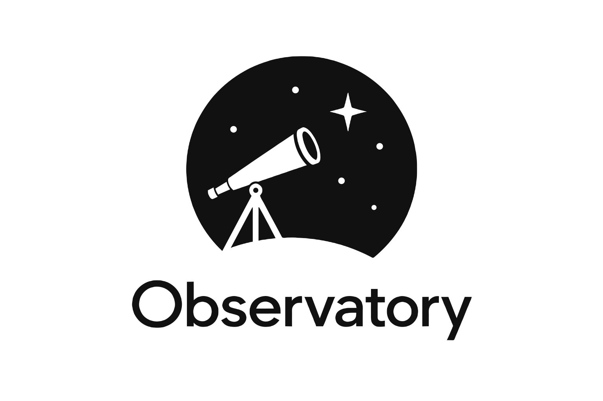

<p align="center"><picture>
  <source media="(prefers-color-scheme: dark)" srcset="observatory-white.svg">
  
</picture></p>

# Observatory

Observatory publishes [Observable Framework](https://observablehq.com/framework/) dashboards
built on a data warehouse, on Cloudflare.

- **The warehouse:** parquet tables and map tiles in R2.
- **The dashboards:** static Framework sites, built from the warehouse.
- **The browser:** DuckDB-WASM queries each page's data.
- **The gate:** a Worker that serves the sites and decides who sees what. People sign in
  with Keycloak, or by email.

Observatory started from the ICR's Campaign Dashboards (recodelabs/icr) and from doorman,
the login Worker, which it absorbs as `packages/gate`.

**Status: early.** The design is in [docs/spec.md](docs/spec.md).

| Package | State |
|---|---|
| `packages/gate` | v0.4: the Worker that serves the sites and decides who sees what: Keycloak and email sign-in, admins and per-site grants, invitations, and an editor that commits small page fixes to GitHub. See its README. |
| `packages/cli` | v0.3: `observatory new`, `dev` (with a page editor beside the preview), `pull`, `build`, `deploy`, `check`; DuckDB 2.0 swap; template site. See its README. |
| `packages/components` | v0.2: `adminMap` (MapLibre + PMTiles), choropleth classes, linked filters. See its README. |

## Develop

Needs Node 22 or later (`.node-version`).

```bash
npm install
npm test --workspaces --if-present
```

`examples/demo` is a one-site project on a made-up warehouse:

```bash
cd examples/demo
npm run warehouse        # makes warehouse/ (needs the duckdb CLI)
npm run dev              # observatory dev demo --local
```

See `packages/gate/README.md` for running the gate locally with wrangler.

### Trying unreleased changes in a project

A project installs the packages from npm. To try changes from this repo before they are
published, install them from the folder, without saving that to the project's
`package.json`:

```bash
cd ../icr/dashboards                       # the project
npm install --no-save ../../observatory/packages/cli ../../observatory/packages/gate
npx observatory dev uganda                 # uses this repo's CLI
```

npm links each folder, so edits here show at once. The next plain `npm install` in the
project puts the published versions back.

## Licence

Apache-2.0. See [LICENSE](LICENSE) and [NOTICE](NOTICE).
